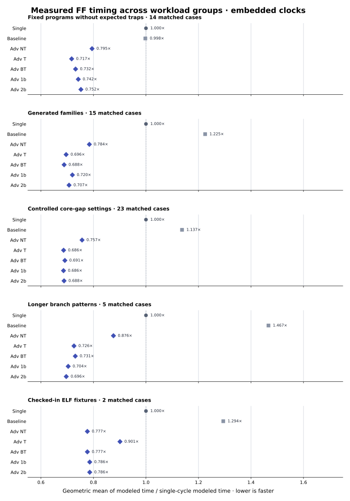
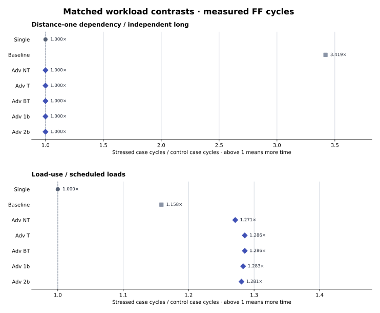
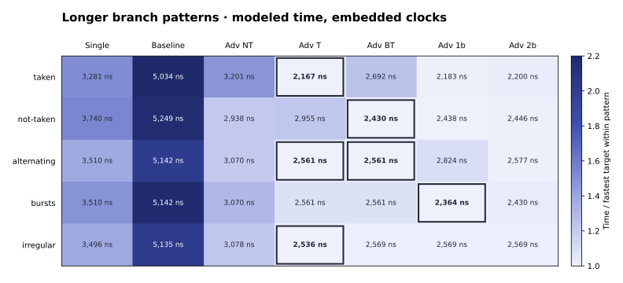
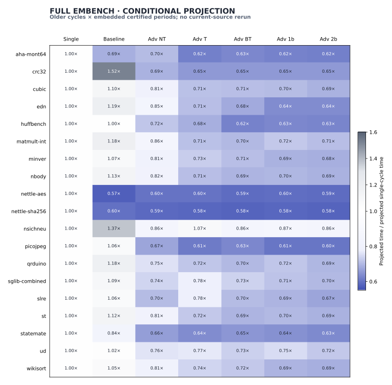

# § 4.7. RV32I Experiment Results

[Experiment setup](4.2/index.md) · [Fixed programs](4.2/programs/index.md) · [Generated workloads](4.2/workloads/index.md) · [Compiled workloads](4.2/compiled/index.md)

This report answers one question: **how do the single-cycle, baseline pipeline,
and advanced pipeline execute the workload groups defined in § 4.2?** For
flip-flop (FF) memory, the advanced core is tested with five branch-prediction
policies, so each full comparison has **seven targets across three cores**.

The tables give **cycle counts**. They are the same in every
[timing profile](../timing.md#timing-profiles): the campaigns were run in
`unit` (October 14, 2026) and again in `embedded` and `desktop` (October 19),
and every case took the same number of cycles. What changes between profiles
is the length of a cycle, the core's certified clock, so modeled time is
**cycles × certified period**, and a shorter clock can beat fewer cycles. The
summaries below are given per profile. The full Embench section is labeled as a
projection from older cycles; it was not rerun.

Read the [comparison rules](#how-to-read-the-results), then follow the groups
in § 4.2 order: [fixed programs](#fixed-programs),
[generated families](#generated-families),
[controlled core-gap cases](#controlled-core-gap-cases), and
[compiled workloads](#compiled-fixtures). The [cross-group comparison](#cross-group-comparison)
brings the measured FF panels together, and
[memory topologies and caches](#memory-topologies-and-caches) runs the advanced
core over DRAM with and without caches.

## Completed campaign coverage

The `unit` campaign completed **497 case/target rows**, each matching the
instruction oracle or fixture verdict and a structural-reference comparison
at its clock, with zero setup violations. The `embedded` and `desktop` reruns
repeated the FF panels: every row matched the oracle and its final memory;
the fixed programs (154), longer branch patterns (35), predictor capacity (3)
and compiled fixtures (14) were also compared with the structural reference,
and the generated families with a structural spot check (15 advanced two-bit
cases, `embedded`). All reported zero setup violations. Rows count panel
entries, **not unique programs**: some workload/target definitions recur in
more than one panel.

| § 4.2 workload group / follow-up | Cases per profile | Where to read the results |
| --- | ---: | --- |
| 22 fixed programs × 7 FF targets | 154 | [Fixed programs](#fixed-programs) |
| 15 generated families × 7 FF targets | 105 | [Generated families](#generated-families) |
| 23 core-gap settings × 7 FF targets | 161 | [Controlled core-gap cases](#controlled-core-gap-cases) |
| 5 longer branch patterns × 7 FF targets | 35 | [Longer branch patterns](#longer-branch-patterns) |
| Predictor capacity settings, advanced/two-bit | 3 | [Predictor capacity](#predictor-capacity) |
| 2 checked-in ELF fixtures × 7 FF targets | 14 | [Compiled fixtures](#compiled-fixtures) |
| 4 workloads × 5 memory topologies, advanced core over DRAM (`embedded`, `desktop` only) | 20 | [Memory topologies and caches](#memory-topologies-and-caches) |

The [full Embench projection](#full-embench-conditional-clock-only-projection)
is outside these measured totals. The timed-memory rows of the October 14
campaign used the memory controllers from before the realistic-timing work and
were not rerun; see [Memory endpoints](#memory-endpoint-follow-up).

## How to read the results

The wide tables report **cycles** for the same case across the seven FF
targets. Columns `Adv NT`, `Adv T`, `Adv BT`, `Adv 1b`, and `Adv 2b` mean the
advanced core with static not-taken, static taken, backward-taken, one-bit,
and two-bit prediction. Single-cycle and baseline use their only not-taken
setting. Unless a section says otherwise, predictors have 16 entries. Fewer
cycles mean fewer clock edges, not less time: multiply by the target's period
in the chosen profile to compare cores.

## Clock certificates

Every target runs at its core's certified clock in the chosen profile (the
advanced core's period is the same for all five policies). The FF results use
binary-startup certificates; the configurations also have unrestricted
four-state analyses ([4.2 Clock analysis](4.2/timing.md)).

<!-- profile-table: clocks -->

The October 14 `unit` campaign ran the advanced core at 100 ticks, the
certificate then; the current `unit` certificate is 94. Its cycles are
unchanged, so the summaries below use 94.

The behavioral run is checked against an instruction oracle or fixture
verdict and a structural CPU reference using the same period. That reference
keeps scalable storage and memory abstractions; it is not a fully expanded
transistor-level machine. § 4.2 describes the [execution contract](4.2/execution.md)
and [equivalence checks](4.2/verification/equivalence.md).

## Results in brief

- With advanced prediction fixed to two-bit, it takes the least time among
  the three cores on **13/14 nontrap fixed programs, 14/15 generated
  families, 20/23 core-gap settings, all five longer branch patterns and
  both compiled fixtures**, in every profile. Baseline still wins selected
  independent-work cases with its shorter clock.
- The advanced core's clock is relatively shorter than when first published:
  single-cycle period / advanced period is 1.77 in `unit` (current
  certificate), 1.75 in `embedded` and 1.74 in `desktop`, against 1.66 with
  the October 14 certificate, so its lead over single-cycle is a little
  larger.
- The best advanced predictor changes with the branch pattern. Two-bit is a
  stable fixed choice in the longer branch panel, but static taken,
  backward-taken, or one-bit wins individual patterns.

*Measured FF group overview.* Each point is an unweighted geometric mean of
matched casewise `target time / single-cycle time` at the `embedded` profile's certified clocks; lower is faster. The
fixed-program panel excludes eight expected traps. The generated and core-gap
groups overlap, so their summaries are separate descriptions, not inputs to
one combined score. The two-fixture panel is deliberately small.

## Fixed programs

The [22 fixed programs](4.2/programs/index.md) test instruction behavior,
expected traps, and six short workloads. All 154 FF target cases completed and
passed the stated checks. Programs 09–16 are **expected trap or fault
outcomes**: their small totals test precise stopping, not throughput.
The other 14 programs provide a short, matched performance comparison.

**Cycles, complete 22 × 7 FF panel:**

| Case | Single | Baseline | Adv NT | Adv T | Adv BT | Adv 1b | Adv 2b |
| --- | ---: | ---: | ---: | ---: | ---: | ---: | ---: |
| [program-01](4.2/programs/program-01.md) | 29 | 72 | 43 | 39 | 39 | 41 | 43 |
| [program-02](4.2/programs/program-02.md) | 35 | 50 | 39 | 39 | 39 | 39 | 39 |
| [program-03](4.2/programs/program-03.md) | 17 | 27 | 21 | 21 | 21 | 21 | 21 |
| [program-04](4.2/programs/program-04.md) | 24 | 56 | 40 | 30 | 40 | 40 | 40 |
| [program-05](4.2/programs/program-05.md) | 11 | 25 | 19 | 19 | 19 | 19 | 19 |
| [program-06](4.2/programs/program-06.md) | 10 | 20 | 14 | 14 | 14 | 14 | 14 |
| [program-07](4.2/programs/program-07.md) | 61 | 123 | 79 | 67 | 67 | 69 | 71 |
| [program-08](4.2/programs/program-08.md) | 42 | 89 | 59 | 53 | 53 | 55 | 57 |
| [program-09](4.2/programs/program-09.md) | 2 | 6 | 6 | 6 | 6 | 6 | 6 |
| [program-10](4.2/programs/program-10.md) | 2 | 6 | 6 | 6 | 6 | 6 | 6 |
| [program-11](4.2/programs/program-11.md) | 2 | 9 | 6 | 6 | 6 | 6 | 6 |
| [program-12](4.2/programs/program-12.md) | 3 | 10 | 7 | 7 | 7 | 7 | 7 |
| [program-13](4.2/programs/program-13.md) | 2 | 9 | 6 | 6 | 6 | 6 | 6 |
| [program-14](4.2/programs/program-14.md) | 3 | 10 | 7 | 7 | 7 | 7 | 7 |
| [program-15](4.2/programs/program-15.md) | 2 | 9 | 6 | 6 | 6 | 6 | 6 |
| [program-16](4.2/programs/program-16.md) | 3 | 12 | 9 | 9 | 9 | 9 | 9 |
| [program-17](4.2/programs/program-17.md) | 73 | 77 | 77 | 77 | 77 | 77 | 77 |
| [program-18](4.2/programs/program-18.md) | 66 | 262 | 70 | 70 | 70 | 70 | 70 |
| [program-19](4.2/programs/program-19.md) | 67 | 169 | 103 | 103 | 103 | 103 | 103 |
| [program-20](4.2/programs/program-20.md) | 51 | 138 | 85 | 57 | 57 | 59 | 61 |
| [program-21](4.2/programs/program-21.md) | 84 | 217 | 134 | 106 | 106 | 108 | 110 |
| [program-22](4.2/programs/program-22.md) | 61 | 129 | 87 | 75 | 75 | 77 | 79 |

Among the 14 nontrap programs, advanced/two-bit takes the least time on 13 in
every profile when comparing only single-cycle, baseline and that fixed
advanced policy; baseline wins the other. (With the October 14 `unit`
certificate of 100 ticks, single-cycle won two of them.) This is not a claim
that two-bit is the best predictor on each program. On program 20,
advanced/taken and advanced/backward-taken each need 57 cycles, versus 61 for
two-bit and 85 for advanced/not-taken; single-cycle needs 51 longer cycles
(in `embedded` 365 ns, against 234 ns for advanced/taken). On program 17 the
baseline's 77 cycles beat advanced/two-bit's 77 because the baseline clock is
shorter (258 ns against 316 ns in `embedded`). Program 04 is close: 24
single-cycle cycles against 40 advanced/two-bit cycles (172 ns against 164 ns
in `embedded`). Including the eight tiny trap cases brings single-cycle to
within 2 % of advanced/two-bit in geometric mean, because fixed pipeline
startup costs dominate those cases; they remain in the complete table but
outside the 14-program performance summary.

### Memory endpoint follow-up

The October 14 campaign also ran the advanced/two-bit core on programs 19–22,
and program 20 with the default not-taken policy, with SRAM, DRAM, ROM or
NOR-flash endpoints. Those memories have since been rebuilt from gates with
datasheet timing (wait cycles chosen from the clock, counted DRAM commands),
so the old rows no longer describe the current design and were not rerun;
they remain in the repository history at tag `timing-legacy`. The current
memory access latencies of every technology and profile are in
[3.6 Memory Timing](../memory/timing.md#measured-latency), and the advanced
core has been run with every memory in `embedded` (all runs oracle-checked)
as part of the realistic-timing work.

## Generated families

The [15 generated families](4.2/workloads/index.md) contribute one
representative case each, run unchanged on all seven FF targets: 105/105
completed cases. The three legacy loops use their own iteration scheme;
the other twelve use eight iterations, size eight and seed one, with sort
and CRC32 capped at two iterations. A family name is not a claim about all
of its possible parameter values.

**Cycles, complete 15 × 7 FF panel:**

| Case | Single | Baseline | Adv NT | Adv T | Adv BT | Adv 1b | Adv 2b |
| --- | ---: | ---: | ---: | ---: | ---: | ---: | ---: |
| [dependent](4.2/workloads/dependent.md) | 44 | 142 | 62 | 50 | 50 | 52 | 54 |
| [alternating](4.2/workloads/alternating.md) | 40 | 130 | 66 | 54 | 54 | 64 | 58 |
| [nested](4.2/workloads/nested.md) | 220 | 603 | 350 | 242 | 242 | 260 | 250 |
| [independent](4.2/workloads/independent.md) | 551 | 625 | 569 | 557 | 557 | 559 | 561 |
| [dependency](4.2/workloads/dependency.md) | 551 | 2,137 | 569 | 557 | 557 | 559 | 561 |
| [load-use](4.2/workloads/load-use.md) | 218 | 468 | 300 | 288 | 288 | 290 | 292 |
| [load-scheduled](4.2/workloads/load-scheduled.md) | 218 | 404 | 236 | 224 | 224 | 226 | 228 |
| [branch-pattern](4.2/workloads/branch-pattern.md) | 70 | 217 | 104 | 92 | 92 | 100 | 96 |
| [branch-alias](4.2/workloads/branch-alias.md) | 161 | 558 | 195 | 183 | 183 | 201 | 187 |
| [calls](4.2/workloads/calls.md) | 170 | 434 | 268 | 256 | 256 | 258 | 260 |
| [stream](4.2/workloads/stream.md) | 519 | 1,156 | 713 | 605 | 605 | 623 | 613 |
| [pointer-chase](4.2/workloads/pointer-chase.md) | 391 | 1,220 | 649 | 541 | 541 | 559 | 549 |
| [sort](4.2/workloads/sort.md) | 453 | 1,166 | 615 | 679 | 567 | 593 | 585 |
| [crc32](4.2/workloads/crc32.md) | 823 | 2,179 | 1,233 | 1,001 | 1,017 | 1,057 | 1,039 |
| [scan](4.2/workloads/scan.md) | 439 | 1,244 | 633 | 525 | 525 | 543 | 533 |

With advanced fixed to two-bit, it takes the least time of the three cores
on 14/15 cases in every profile. `independent` is the exception: baseline
needs 625 cycles and advanced/two-bit 561, but the baseline clock is shorter
(2.10 µs against 2.30 µs in `embedded`). The `dependency` case keeps the same
551 single-cycle cycles as `independent`, while baseline rises from 625 to
2,137; advanced/two-bit stays at 561. This is the intended
dependency/forwarding contrast. Scheduling the load-use work lowers
advanced/two-bit from 292 to 228 cycles and removes the observed 64 load-use
stalls without changing the intended computation. Taken and backward-taken
often outperform two-bit on these short cases; the full table shows every
policy instead of selecting a winner after each run.

## Controlled core-gap cases

The [core-gap preset](4.2/campaigns.md) varies one pressure at a time while
holding each case identical across the seven FF targets: 23 settings, 161/161
completed cases. Some settings intentionally repeat a generated-family case.
These are controlled diagnostics, so their rows must not be counted as 23
independent real programs. Sort and CRC32 again use two iterations; the other
whole-program cases use eight iterations, size eight and seed one.

### Dependencies and load scheduling

**Cycles, eight controlled settings:**

| Case | Single | Baseline | Adv NT | Adv T | Adv BT | Adv 1b | Adv 2b |
| --- | ---: | ---: | ---: | ---: | ---: | ---: | ---: |
| independent-short | 89 | 128 | 93 | 95 | 95 | 93 | 93 |
| independent-long | 551 | 625 | 569 | 557 | 557 | 559 | 561 |
| dependency-d1 | 551 | 2,137 | 569 | 557 | 557 | 559 | 561 |
| dependency-d2 | 551 | 1,121 | 569 | 557 | 557 | 559 | 561 |
| dependency-d4 | 551 | 625 | 569 | 557 | 557 | 559 | 561 |
| dependency-d8 | 551 | 625 | 569 | 557 | 557 | 559 | 561 |
| load-use | 218 | 468 | 300 | 288 | 288 | 290 | 292 |
| load-scheduled | 218 | 404 | 236 | 224 | 224 | 226 | 228 |

The distance-one dependency makes baseline take 2,137 cycles while
advanced/two-bit takes 561. At distance four or eight, baseline falls to 625
cycles and beats advanced/two-bit in time despite using more cycles, because
its clock is shorter in every profile. On the immediate load-use case,
advanced/two-bit takes 292 cycles and records 64 load-use stalls. Scheduling
the same work takes 228 with zero such stalls. These pairs identify the
intended hazard; they do not isolate every cause in a compiled program.

*Matched controlled contrasts.* A value above one means the stressed case
takes more cycles than its paired control. Both panels show the three
cores and every advanced prediction mode; they compare selected workload
settings rather than attributing all costs in compiled programs.

### Branch direction, aliasing, and training

**Cycles, nine controlled settings:**

| Case | Single | Baseline | Adv NT | Adv T | Adv BT | Adv 1b | Adv 2b |
| --- | ---: | ---: | ---: | ---: | ---: | ---: | ---: |
| branch-taken | 66 | 213 | 108 | 80 | 96 | 84 | 88 |
| branch-not-taken | 74 | 221 | 100 | 104 | 88 | 90 | 92 |
| branch-alternating | 70 | 217 | 104 | 92 | 92 | 100 | 96 |
| branch-bursts | 74 | 221 | 100 | 104 | 88 | 90 | 92 |
| branch-irregular | 69 | 216 | 105 | 89 | 93 | 95 | 99 |
| alias-spacing8 | 97 | 302 | 131 | 119 | 119 | 107 | 111 |
| alias-spacing16 | 161 | 558 | 195 | 183 | 183 | 201 | 187 |
| branch-body-training0 | 56 | 184 | 94 | 66 | 82 | 70 | 74 |
| branch-body-training32 | 56 | 184 | 94 | 66 | 82 | 66 | 66 |

Changing branch direction alters which advanced policy wins. The
body-window training pair measures the same branch body after zero or 32
real prefix iterations. Advanced/two-bit drops from 74 cycles
to 66, and observed next-PC misses fall from five to one. The
training prefix is executed and verified but lies outside the measured body;
these rows are not whole-program time comparisons.

### Calls, memory kernels, sort, and CRC32

**Cycles, six controlled settings:**

| Case | Single | Baseline | Adv NT | Adv T | Adv BT | Adv 1b | Adv 2b |
| --- | ---: | ---: | ---: | ---: | ---: | ---: | ---: |
| calls | 170 | 434 | 268 | 256 | 256 | 258 | 260 |
| stream | 519 | 1,156 | 713 | 605 | 605 | 623 | 613 |
| pointer-chase | 391 | 1,220 | 649 | 541 | 541 | 559 | 549 |
| scan | 439 | 1,244 | 633 | 525 | 525 | 543 | 533 |
| sort | 453 | 1,166 | 615 | 679 | 567 | 593 | 585 |
| crc32 | 823 | 2,179 | 1,233 | 1,001 | 1,017 | 1,057 | 1,039 |

This last cluster tests calls and data-heavy kernels under the same seven
targets. It supplies workload diversity to the 23-case panel, but a
two-iteration sort or CRC32 row is still only its declared generated input.

### Longer branch patterns

The separate 64-iteration [branch-pattern](4.2/workloads/branch-pattern.md)
campaign extends the five direction patterns beyond the short core-gap cases.
All 35 cases completed with 16 predictor entries and the same FF clocks.
Each cell below is **cycles**; the record lists the modeled time of every cell in `embedded` and `desktop`.

| Target | taken | not-taken | alternating | bursts | irregular |
| --- | ---: | ---: | ---: | ---: | ---: |
| Single | 458 | 522 | 490 | 490 | 488 |
| Baseline | 1,501 | 1,565 | 1,533 | 1,533 | 1,531 |
| Adv NT | 780 | 716 | 748 | 748 | 750 |
| Adv T | 528 | 720 | 624 | 624 | 618 |
| Adv BT | 656 | 592 | 624 | 624 | 626 |
| Adv 1b | 532 | 594 | 688 | 576 | 626 |
| Adv 2b | 536 | 596 | 628 | 592 | 626 |

*Longer branch patterns, 64 iterations each.* Cell labels are modeled time at the
`embedded` profile's certified clocks. Color shows each value divided by the fastest target in the
same pattern; outlines mark the fastest value or ties. Compare targets within
a row, since branch patterns can execute different amounts of work.

Advanced/two-bit is faster than single-cycle and baseline on all five
matched patterns in every profile, yet it is **not** the fastest advanced
policy on every pattern. Taken wins always-taken and irregular;
backward-taken wins always-not-taken; taken and backward-taken tie on
alternating; one-bit wins bursts. Two-bit remains within 2.8 % of each
pattern's best and has the lowest unweighted geometric mean across these
five advanced-policy rows. One ordering differs from the first publication:
with the October 14 certificate single-cycle beat advanced/not-taken on the
taken pattern (458 against 780 cycles at 166 and 100 ticks); with the current
certificates every advanced policy beats single-cycle on every pattern. That
is a result for these patterns, not a universal predictor choice.

### Predictor capacity

A separate 64-iteration aliasing case varied only the advanced/two-bit
predictor's entry count:

| Entries | Cycles | Next-PC misses |
| ---: | ---: | ---: |
| 8 | 1,363 | 67 |
| 16 | 1,363 | 67 |
| 32 | 1,239 | 5 |

For this spacing-16 address pattern, 32 entries reduce modeled time by
9.1% relative to 8 or 16. This capacity experiment is not part of the
seven-target policy sweep and does not establish a general size optimum.

## Compiled fixtures

The two [checked-in ELF fixtures](4.2/compiled/index.md#checked-in-fixtures)
test external loading and compiler-produced RV32I code without a full
Embench workload. Both passed their verdict, oracle and structural checks
on all seven FF targets: 14/14 measured cases.

**Cycles, complete 2 × 7 FF panel:**

| Case | Single | Baseline | Adv NT | Adv T | Adv BT | Adv 1b | Adv 2b |
| --- | ---: | ---: | ---: | ---: | ---: | ---: | ---: |
| self-check.elf | 19 | 56 | 26 | 32 | 26 | 26 | 26 |
| compiled.elf | 64 | 166 | 86 | 94 | 86 | 88 | 88 |

Advanced/two-bit takes the least time among the three fixed core choices on
both small fixtures, in every profile. These images are dominated by startup and control work;
they do not measure the full applications in the next section. The
reduced-work Embench middle suite has no current-source result in this
report.

## Full Embench: conditional clock-only projection

The previously completed full campaign covered **19 Embench workloads ×
seven targets** with original verifiers and instruction-oracle checks, but
**without structural-reference checks**. It used an older source snapshot.
These full workloads were **not rerun** for this report. The cells below are
those **historical cycle counts**, so any modeled time derived from them is a
**projection, not a current-source measurement**.

**Historical cycles, all 19 × 7 target cells:**

| Workload | Single | Baseline | Adv NT | Adv T | Adv BT | Adv 1b | Adv 2b |
| --- | ---: | ---: | ---: | ---: | ---: | ---: | ---: |
| [aha-mont64](4.2/compiled/aha-mont64.md) | 11,425,502 | 16,739,060 | 14,019,466 | 12,357,832 | 12,564,698 | 12,380,704 | 12,312,016 |
| [crc32](4.2/compiled/crc32.md) | 6,130,443 | 19,966,346 | 7,356,891 | 7,007,039 | 7,007,033 | 7,007,375 | 7,007,039 |
| [cubic](4.2/compiled/cubic.md) | 30,287,860 | 71,399,587 | 42,590,615 | 37,505,317 | 37,296,609 | 37,130,343 | 36,513,847 |
| [edn](4.2/compiled/edn.md) | 75,135,316 | 191,060,158 | 111,910,206 | 92,733,864 | 89,051,016 | 83,631,098 | 83,518,500 |
| [huffbench](4.2/compiled/huffbench.md) | 2,693,952 | 5,749,891 | 3,365,737 | 3,215,457 | 2,922,743 | 2,963,505 | 2,940,475 |
| [matmult-int](4.2/compiled/matmult-int.md) | 29,506,443 | 74,426,421 | 44,177,157 | 36,564,643 | 36,015,495 | 37,160,367 | 36,407,605 |
| [minver](4.2/compiled/minver.md) | 12,751,619 | 29,064,911 | 17,987,531 | 16,165,139 | 15,762,493 | 15,306,379 | 15,227,437 |
| [nbody](4.2/compiled/nbody.md) | 27,246,935 | 65,541,011 | 38,868,841 | 33,659,173 | 32,939,523 | 33,132,073 | 32,826,229 |
| [nettle-aes](4.2/compiled/nettle-aes.md) | 4,807,300 | 5,875,634 | 5,044,530 | 5,046,090 | 4,957,130 | 4,998,206 | 4,940,870 |
| [nettle-sha256](4.2/compiled/nettle-sha256.md) | 4,099,001 | 5,219,708 | 4,206,627 | 4,177,117 | 4,158,071 | 4,168,539 | 4,160,961 |
| [nsichneu](4.2/compiled/nsichneu.md) | 2,238,725 | 6,562,009 | 3,379,608 | 4,175,512 | 3,377,174 | 3,406,714 | 3,354,964 |
| [picojpeg](4.2/compiled/picojpeg.md) | 5,241,766 | 11,818,952 | 6,129,158 | 5,591,750 | 5,768,474 | 5,537,090 | 5,519,994 |
| [qrduino](4.2/compiled/qrduino.md) | 6,032,091 | 15,169,390 | 7,948,406 | 7,543,352 | 7,374,356 | 7,556,310 | 7,317,850 |
| [sglib-combined](4.2/compiled/sglib-combined.md) | 2,975,542 | 6,906,791 | 3,828,677 | 4,063,561 | 3,808,805 | 3,698,971 | 3,637,847 |
| [slre](4.2/compiled/slre.md) | 2,533,787 | 5,732,802 | 3,104,696 | 3,452,584 | 3,104,482 | 3,061,616 | 2,969,702 |
| [st](4.2/compiled/st.md) | 17,895,271 | 42,991,287 | 25,458,239 | 22,453,967 | 21,590,901 | 21,850,025 | 21,484,209 |
| [statemate](4.2/compiled/statemate.md) | 1,684,582 | 3,023,302 | 1,938,243 | 1,875,385 | 1,914,555 | 1,887,029 | 1,855,627 |
| [ud](4.2/compiled/ud.md) | 6,771,211 | 14,687,130 | 8,966,161 | 9,051,945 | 8,658,491 | 8,868,513 | 8,531,311 |
| [wikisort](4.2/compiled/wikisort.md) | 6,310,064 | 14,142,504 | 8,959,126 | 8,149,074 | 7,926,686 | 7,644,544 | 7,552,916 |

*Conditional full Embench projection, not a current-source measurement* (`embedded` clocks). Each
cell shows projected `target time / single-cycle time` for that workload;
the single-cycle reference is visible at 1.0. The table above gives the
historical cycle counts. These relative colors are conditional on the older
cycle counts remaining unchanged.

If the old cycle counts were unchanged, advanced/two-bit would take the least
projected time among the three fixed core choices on all 19 workloads in
`unit` and on 18/19 in `embedded` and `desktop`, where baseline would lead
`nettle-aes`. The unweighted geometric-mean projected ratios to
advanced/two-bit are 1.52× (`unit`), 1.50× (`embedded`, `desktop`) for
single-cycle and 1.58×, 1.52× and 1.52× for baseline. This arithmetic is
conditional and is **not** a newly validated full Embench comparison, an
official normalized Embench score, or evidence that the current source
retains the old cycle counts. The full run includes startup, in-program
warmup, repetitions and verification; the small checked-in fixtures and
reduced middle suite do not replace it.

## Cross-group comparison

For a consistent three-core comparison on **measured FF results**, hold
advanced prediction at two-bit and compare exactly the same cases within each
group. The ratios are unweighted geometric means of
`other core time / advanced two-bit time` (time = cycles × the profile's
certified period); values above one favor advanced. The winner counts
compare just those three fixed targets. The eight tiny expected-trap programs
are omitted from the first summary, though their results remain in the
fixed-program table.

| Measured group | Matched cases | Least time: single / baseline / advanced 2b | Single / advanced 2b: `unit`, `embedded`, `desktop` | Baseline / advanced 2b: `unit`, `embedded`, `desktop` |
| --- | ---: | ---: | ---: | ---: |
| Fixed programs excluding expected traps | 14 | 0 / 1 / 13 | 1.345×, 1.329×, 1.329× | 1.381×, 1.326×, 1.325× |
| Generated families | 15 | 0 / 1 / 14 | 1.431×, 1.414×, 1.414× | 1.805×, 1.733×, 1.732× |
| Core-gap settings | 23 | 0 / 3 / 20 | 1.470×, 1.453×, 1.453× | 1.722×, 1.653×, 1.652× |
| Longer branch patterns | 5 | 0 / 0 / 5 | 1.453×, 1.436×, 1.435× | 2.193×, 2.106×, 2.105× |

The winner counts are the same in all three profiles. The advanced pipeline
usually compensates for its longer clock by saving cycles through forwarding
and prediction. The baseline's shorter clock can still win on independent
work, while dependency and branch stalls can erase that advantage; the
baseline's relative clock is a little better in the realistic profiles, so
its ratios are lower there. Across these groups, there is **no single winner
for every workload or advanced predictor policy**. Groups overlap in
generated definitions, so these ratios are separate descriptions, not
independent benchmark scores to average together.

## Memory topologies and caches

Does the advanced core run faster with [caches](../memory/caches.md) between
it and DRAM main memory, and which arrangement helps? The same core, with the
same DRAM, was connected in five ways and run in both realistic profiles at
its certified clock (`embedded` 4,104 ps, `desktop` 2,858 ps; the
[clock analysis](4.2/timing.md#certified-clocks) certifies every topology at
that clock).

<!-- diagram: cache-topologies -->

**Setup**, fixed before any run: the instruction and data L1s are 8 sets × 2
ways × 16-byte lines (256 B each), the shared L2 64 sets × 2 ways × 16-byte
lines (2 KiB), all with SRAM tag and data stores; lines are filled with one
burst; the data caches write through and do not allocate on a write miss.
Main memory is one DRAM of 65,536 words with the profile's datasheet rows
(512 words in `embedded`, 1,024 in `desktop`) and refresh. The workloads are
`calls` (size 16, 256 measured iterations), `sort` (64 words: its 512-byte
working set is larger than an L1 and smaller than the L2, 4 iterations),
`stream` (1,024 words, larger than the L2, 4 iterations) and `pointer-chase`
(512 nodes, 4 KiB, random dependent loads, 4 iterations); each window starts
after one warm-up iteration. Every run matched the instruction oracle and the
expected final memory, with zero setup violations.

**Latency of one read** (cycles at the certified clock; [3.6](../memory/timing.md)
gives the memory alone):

| Read | `embedded` | `desktop` |
| --- | ---: | ---: |
| L1 hit | 2 | 2 |
| L2 hit after an L1 miss | 8 | 8 |
| DRAM, row open | 8 | 8 |
| DRAM, row closed | 14 | 15 |
| DRAM, other row open | 20 | 22 |
| L1 miss to DRAM, row open / closed | 14 / 20 | 14 / 21 |
| L1 and L2 miss to DRAM, row open / closed | 17 / 23 | 17 / 24 |

**Cycles in the measured window**, with cycles per instruction and the speed
against the shared, uncached topology B:

**calls**

| Topology | `embedded` cycles | CPI | vs B | `desktop` cycles | CPI | vs B |
| --- | ---: | ---: | ---: | ---: | ---: | ---: |
| A | 62,529 | 12.21 | 1.51× | 65,944 | 12.88 | 1.57× |
| B | 94,309 | 18.42 | 1.00× | 103,331 | 20.18 | 1.00× |
| C-ID | 26,321 | 5.14 | 3.58× | 28,499 | 5.57 | 3.63× |
| D-0 | 27,296 | 5.33 | 3.46× | 29,144 | 5.69 | 3.55× |
| D-ID | 27,820 | 5.43 | 3.39× | 29,665 | 5.79 | 3.48× |

**sort**

| Topology | `embedded` cycles | CPI | vs B | `desktop` cycles | CPI | vs B |
| --- | ---: | ---: | ---: | ---: | ---: | ---: |
| A | 281,202 | 10.14 | 1.99× | 302,048 | 10.89 | 2.08× |
| B | 559,942 | 20.19 | 1.00× | 628,588 | 22.67 | 1.00× |
| C-ID | 142,446 | 5.14 | 3.93× | 157,293 | 5.67 | 4.00× |
| D-0 | 150,892 | 5.44 | 3.71× | 165,890 | 5.98 | 3.79× |
| D-ID | 153,511 | 5.54 | 3.65× | 168,220 | 6.07 | 3.74× |

**stream**

| Topology | `embedded` cycles | CPI | vs B | `desktop` cycles | CPI | vs B |
| --- | ---: | ---: | ---: | ---: | ---: | ---: |
| A | 410,643 | 14.31 | 1.38× | 451,632 | 15.73 | 1.40× |
| B | 567,601 | 19.77 | 1.00× | 632,355 | 22.03 | 1.00× |
| C-ID | 185,577 | 6.47 | 3.06× | 205,977 | 7.18 | 3.07× |
| D-0 | 194,892 | 6.79 | 2.91× | 215,278 | 7.50 | 2.94× |
| D-ID | 201,013 | 7.00 | 2.82× | 222,082 | 7.74 | 2.85× |

**pointer-chase**

| Topology | `embedded` cycles | CPI | vs B | `desktop` cycles | CPI | vs B |
| --- | ---: | ---: | ---: | ---: | ---: | ---: |
| A | 134,203 | 13.06 | 1.85× | 125,641 | 12.23 | 2.19× |
| B | 248,769 | 24.22 | 1.00× | 275,375 | 26.81 | 1.00× |
| C-ID | 82,295 | 8.01 | 3.02× | 72,584 | 7.07 | 3.79× |
| D-0 | 75,971 | 7.40 | 3.27× | 69,702 | 6.79 | 3.95× |
| D-ID | 79,289 | 7.72 | 3.14× | 73,041 | 7.11 | 3.77× |

**What the counters show:**

- **Sharing one DRAM (A → B) costs 1.4–2.2×.** The two ports rarely request
  in the same cycle; the cost is DRAM row changes. In `sort` (`embedded`),
  A opens 796 rows in its two memories, B's shared DRAM 18,377, because
  instruction fetches and data accesses interleave on one device; at about
  twelve cycles per row change that accounts for most of B's extra cycles.
- **The L1 pair (B → C-ID) gives 3–4×.** The code fits the instruction L1;
  the data L1 holds part of `sort`'s working set.
- **The L2 alone (B → D-0) gives almost as much**, because an L2 hit of one
  word costs about as much as an L1 hit at these clocks.
- **Both levels (C-ID → D-ID) are 4–8 % slower than the L1s alone** in
  `calls`, `sort` and `stream`. Every store is written through two levels
  and the core waits for each write; serving the data L1's misses from the
  L2 saves less than that costs. Only `pointer-chase`, which misses the L1
  on almost every load, gains from the L2 under the L1s in `embedded`. This
  is a property of the caches as built (write-through, one outstanding
  request, no write buffer), not of the memory timing.
- **Random access favors the larger cache.** In `pointer-chase` the 256-byte
  L1 rarely holds a node and each miss fetches a whole line, so the L2 alone
  (D-0) is fastest. In `desktop` the whole 4 KiB array sits in one DRAM row.

**Locality, without a CPU** (2,048 reads, cycles per read, `embedded` /
`desktop`; S0 reads DRAM directly, S1 through an L1, S2 through an L1 and
the L2):

| Access pattern | S0 DRAM | S1 L1 | S2 L1 + L2 |
| --- | ---: | ---: | ---: |
| Sequential | 8.05 / 8.03 | 5.08 / 5.26 | 5.83 / 6.07 |
| One word per cache line | 8.12 / 8.08 | 14.29 / 14.79 | 17.32 / 17.97 |
| One word per DRAM row | 19.93 / 21.94 | 26.20 / 29.31 | 29.19 / 32.46 |

Sequential access is 2.5× faster than row-hopping with no cache at all and
about 5× faster with an L1. A cache makes access with no spatial locality
slower (one word per line: 14.3 cycles through an L1 against 8.1 without),
since every miss fetches four words to use one.

These results cover the stated geometry, policies and inputs. They are not
a general cache ranking: a write-back cache, a write buffer, more
outstanding requests or a multi-bank DRAM would be new designs with their
own results. No memory interval or cache policy was changed after seeing
results.

## Interpretation and evidence limits

The measured tables above record the selected inputs and target settings,
not every possible RV32I program, predictor size, or memory/core pairing.
Single-cycle and baseline were tested only with FF memory; the current
timed memories are described by their measured latencies in 3.6. The structural reference checks an affordable CPU datapath and
scalable memory abstractions. It does not turn a finite campaign into a
proof of every implementation state.

All displayed results are cycles or simulated time. Host execution seconds were
recorded with only one measurement and no host warmup, so they are not a
stable host-speed ranking. The full Embench section remains a projection
until its complete ELFs are rerun on the current source. Changes to
circuitry, delay tables, memory response rules, predictor capacity, or clock
contracts require new certificates and, where cycles can change, new
program results.

