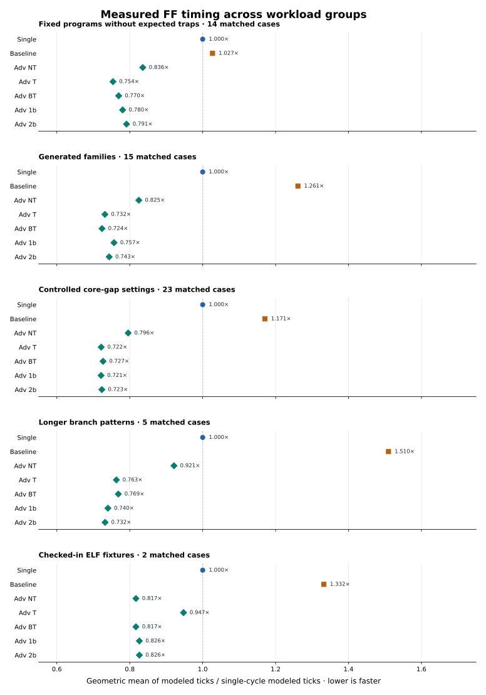
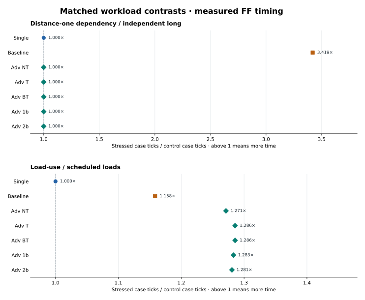
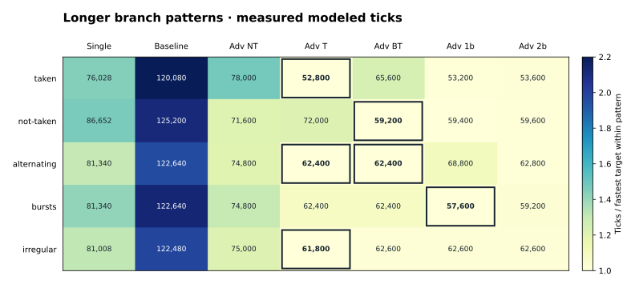
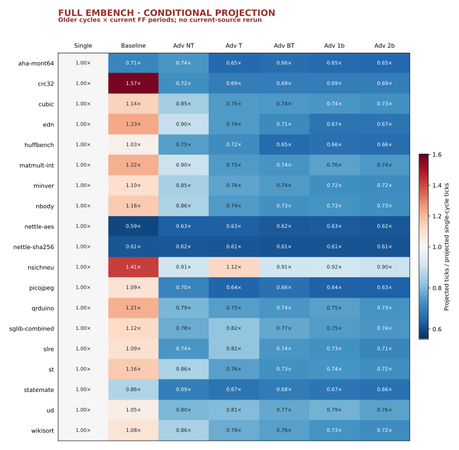

# § 4.7. RV32I Experiment Results

[Experiment setup](4.2/index.md) · [Fixed programs](4.2/programs/index.md) · [Generated workloads](4.2/workloads/index.md) · [Compiled workloads](4.2/compiled/index.md)

This report answers one question: **how do the single-cycle, baseline pipeline,
and advanced pipeline execute the workload groups defined in § 4.2?** For FF
memory, the advanced core is tested with five branch-prediction policies, so
each full comparison has **seven targets across three cores**. The measured
campaigns completed on October 14, 2026. The full Embench section is clearly
labeled as a projection from older cycles; it was not rerun on this source.

Read the [comparison rules](#how-to-read-the-results), then follow the groups
in § 4.2 order: [fixed programs](#fixed-programs),
[generated families](#generated-families),
[controlled core-gap cases](#controlled-core-gap-cases), and
[compiled workloads](#compiled-fixtures). The [cross-group comparison](#cross-group-comparison)
brings the measured FF panels together.

## Completed campaign coverage

All **497 current-source case/target rows** completed their intended program
or fixture verdict, matched the instruction oracle where applicable, and
passed a structural-reference comparison at the reported clock period. They
reported zero setup violations. The three broad FF campaigns also had a
separate measurement phase. This counts panel rows, **not unique programs**:
some workload/target definitions recur in more than one panel.

| § 4.2 workload group / follow-up | Current measured cases | Structural checks | Where to read the results |
| --- | ---: | ---: | --- |
| 22 fixed programs × 7 FF targets | 154 | 154 | [Fixed programs](#fixed-programs) |
| 15 generated families × 7 FF targets | 105 | 105 | [Generated families](#generated-families) |
| 23 core-gap settings × 7 FF targets | 161 | 161 | [Controlled core-gap cases](#controlled-core-gap-cases) |
| 5 longer branch patterns × 7 FF targets | 35 | 35 | [Longer branch patterns](#longer-branch-patterns) |
| Compatible advanced/two-bit FF and timed-memory pairs | 18 | 18 | [Memory endpoint follow-up](#memory-endpoint-follow-up) |
| Separate program-20 default-policy core/memory pairs | 7 | 7 | [Default-policy program-20 check](#default-policy-program-20-check) |
| Predictor capacity settings, advanced/two-bit | 3 | 3 | [Predictor capacity](#predictor-capacity) |
| 2 checked-in ELF fixtures × 7 FF targets | 14 | 14 | [Compiled fixtures](#compiled-fixtures) |
| **Total measured panel rows** | **497** | **497** | |

The [full Embench projection](#full-embench-conditional-clock-only-projection)
is outside this measured total. The reduced-work Embench middle suite also has
no current-source result here.

## How to read the results

The wide tables report **modeled execution ticks** for the same case across
the seven FF targets. Columns `Adv NT`, `Adv T`, `Adv BT`, `Adv 1b`, and
`Adv 2b` mean the advanced core with static not-taken, static taken,
backward-taken, one-bit, and two-bit prediction. Single-cycle and baseline
use their only not-taken setting. Unless a section says otherwise, predictors
have 16 entries. A lower tick count means less **simulated time for that
case**, not less host time or a higher physical clock rate.

## Current clock certificates, 2026-10-13

The current experiment binary's ten clock analyses were rechecked on October
14; all reported `safe-under-contracts`. The FF results use binary-startup
certificates; the FF configurations also have unrestricted four-state analyses. The timed
endpoints have unrestricted four-state analyses only.

| Target and endpoint | Certified ticks per CPU cycle |
| --- | ---: |
| Single-cycle, zero-wait FF | **166** |
| Baseline five-stage, zero-wait FF | **80** |
| Advanced five-stage, zero-wait FF (all five policies) | **100** |
| Advanced five-stage, SRAM / DRAM / ROM / NOR-flash | **102** |

**Ticks = completed CPU cycles × that run's period.** Divide any FF table
cell by its column's period to recover the exact cycle count. Periods are
fixed within a run; behavioral propagation delays and memory response waits
can vary with the work. The four timed endpoints share a sufficient 102-tick
period because the present instruction-request ready path limits all four
configurations, despite their different access sequences and response waits.
These are modeled clock periods, not physical frequency measurements.

The behavioral run is checked against an instruction oracle or fixture
verdict and a structural CPU reference using the same period. That reference
keeps scalable storage and memory abstractions; it is not a fully expanded
transistor-level machine. § 4.2 describes the [execution contract](4.2/execution.md)
and [equivalence checks](4.2/verification/equivalence.md).

## Results in brief

- With advanced prediction fixed to two-bit, it has the lowest modeled ticks
  among the three cores on **11/14 nontrap fixed programs, 14/15 generated
  families, 20/23 core-gap settings, and all five longer branch patterns**.
  Baseline still wins selected independent-work cases with its shorter clock.
- The best advanced predictor changes with the branch pattern. Two-bit is a
  stable fixed choice in the longer branch panel, but static taken,
  backward-taken, or one-bit wins individual patterns.
- Timed memory changes the advanced core's **cycle count** as well as its
  clock period. The full Embench comparison below remains a **projection**,
  so it is not included in these measured conclusions.

*Measured FF group overview.* Each point is an unweighted geometric mean of
matched casewise `target ticks / single-cycle ticks`; lower is faster. The
fixed-program panel excludes eight expected traps. The generated and core-gap
groups overlap, so their summaries are separate descriptions, not inputs to
one combined score. The two-fixture panel is deliberately small.

## Fixed programs

The [22 fixed programs](4.2/programs/index.md) test instruction behavior,
expected traps, and six short workloads. All 154 FF target cases completed and
passed the stated checks. Programs 09–16 are **expected trap or fault
outcomes**: their small tick totals test precise stopping, not throughput.
The other 14 programs provide a short, matched performance comparison.

**Modeled ticks, complete 22 × 7 FF panel:**

| Case | Single | Baseline | Adv NT | Adv T | Adv BT | Adv 1b | Adv 2b |
| --- | ---: | ---: | ---: | ---: | ---: | ---: | ---: |
| [program-01](4.2/programs/program-01.md) | 4,814 | 5,760 | 4,300 | 3,900 | 3,900 | 4,100 | 4,300 |
| [program-02](4.2/programs/program-02.md) | 5,810 | 4,000 | 3,900 | 3,900 | 3,900 | 3,900 | 3,900 |
| [program-03](4.2/programs/program-03.md) | 2,822 | 2,160 | 2,100 | 2,100 | 2,100 | 2,100 | 2,100 |
| [program-04](4.2/programs/program-04.md) | 3,984 | 4,480 | 4,000 | 3,000 | 4,000 | 4,000 | 4,000 |
| [program-05](4.2/programs/program-05.md) | 1,826 | 2,000 | 1,900 | 1,900 | 1,900 | 1,900 | 1,900 |
| [program-06](4.2/programs/program-06.md) | 1,660 | 1,600 | 1,400 | 1,400 | 1,400 | 1,400 | 1,400 |
| [program-07](4.2/programs/program-07.md) | 10,126 | 9,840 | 7,900 | 6,700 | 6,700 | 6,900 | 7,100 |
| [program-08](4.2/programs/program-08.md) | 6,972 | 7,120 | 5,900 | 5,300 | 5,300 | 5,500 | 5,700 |
| [program-09](4.2/programs/program-09.md) | 332 | 480 | 600 | 600 | 600 | 600 | 600 |
| [program-10](4.2/programs/program-10.md) | 332 | 480 | 600 | 600 | 600 | 600 | 600 |
| [program-11](4.2/programs/program-11.md) | 332 | 720 | 600 | 600 | 600 | 600 | 600 |
| [program-12](4.2/programs/program-12.md) | 498 | 800 | 700 | 700 | 700 | 700 | 700 |
| [program-13](4.2/programs/program-13.md) | 332 | 720 | 600 | 600 | 600 | 600 | 600 |
| [program-14](4.2/programs/program-14.md) | 498 | 800 | 700 | 700 | 700 | 700 | 700 |
| [program-15](4.2/programs/program-15.md) | 332 | 720 | 600 | 600 | 600 | 600 | 600 |
| [program-16](4.2/programs/program-16.md) | 498 | 960 | 900 | 900 | 900 | 900 | 900 |
| [program-17](4.2/programs/program-17.md) | 12,118 | 6,160 | 7,700 | 7,700 | 7,700 | 7,700 | 7,700 |
| [program-18](4.2/programs/program-18.md) | 10,956 | 20,960 | 7,000 | 7,000 | 7,000 | 7,000 | 7,000 |
| [program-19](4.2/programs/program-19.md) | 11,122 | 13,520 | 10,300 | 10,300 | 10,300 | 10,300 | 10,300 |
| [program-20](4.2/programs/program-20.md) | 8,466 | 11,040 | 8,500 | 5,700 | 5,700 | 5,900 | 6,100 |
| [program-21](4.2/programs/program-21.md) | 13,944 | 17,360 | 13,400 | 10,600 | 10,600 | 10,800 | 11,000 |
| [program-22](4.2/programs/program-22.md) | 10,126 | 10,320 | 8,700 | 7,500 | 7,500 | 7,700 | 7,900 |

Among the 14 nontrap programs, advanced/two-bit has the fewest ticks on 11
when comparing only single-cycle, baseline, and that fixed advanced policy;
single-cycle wins two and baseline wins one. This is not a claim that two-bit
is the best predictor on each program. On program 20, advanced/taken and
advanced/backward-taken each need 5,700 ticks, versus 6,100 for two-bit and
8,500 for advanced/not-taken. On program 17, the baseline's 6,160 ticks beat
advanced/two-bit's 7,700 because the baseline period is shorter. Program 04
is nearly tied between single-cycle (3,984) and advanced/two-bit (4,000).
Including the eight tiny trap cases reverses the single/advanced geometric
mean, because fixed pipeline startup costs dominate those cases; they remain
in the complete table but outside the 14-program performance summary.

### Memory endpoint follow-up

The advanced/two-bit core also ran fixed programs 19–22 with both instruction
and data memory set to the same endpoint. A cell is **cycles / modeled ticks**;
the FF column uses period 100 and timed columns use 102. All 18 selected
pairs passed the oracle, structural comparison, final-state and observed
handshake checks.

| Program | FF (100) | SRAM (102) | DRAM (102) | ROM (102) | NOR-flash (102) |
| --- | ---: | ---: | ---: | ---: | ---: |
| [program-19](4.2/programs/program-19.md) | 103 / 10,300 | 470 / 47,940 | 648 / 66,096 | 470 / 47,940 | 403 / 41,106 |
| [program-20](4.2/programs/program-20.md) | 61 / 6,100 | 328 / 33,456 | 507 / 51,714 | 328 / 33,456 | 274 / 27,948 |
| [program-21](4.2/programs/program-21.md) | 110 / 11,000 | 558 / 56,916 | 807 / 82,314 | 558 / 56,916 | 471 / 48,042 |
| [program-22](4.2/programs/program-22.md) | 79 / 7,900 | 420 / 42,840 | 655 / 66,810 | — | — |

Programs 19–21 support all five endpoints.
Program 22 writes data, so read-only ROM and NOR-flash were not selected for
it. Both instruction and data endpoints change together; program 20 has no
data-memory access and therefore isolates instruction-fetch behavior in this
panel. For program 21, all five modes retire 83 instructions and reach the
same final state, but FF needs 11,000 ticks, SRAM and ROM 56,916, NOR-flash
48,042, and DRAM 82,314. The timed modes share a clock period while their
cycle counts differ. These small inputs do not establish a general ranking
of memory technologies. Overlapping wait counters cannot be added into a
single stall total.

### Default-policy program-20 check

A separate seven-pair check used the advanced core's **default not-taken**
policy, rather than the two-bit policy in the memory panel. Its three FF rows
also occur in the complete fixed-program table. Keeping this small check
separate avoids conflating predictor and memory changes.

| Core | Memory | Period | Cycles | Modeled ticks |
| --- | ---: | ---: | ---: | ---: |
| single | FF | 166 | 51 | 8,466 |
| baseline | FF | 80 | 138 | 11,040 |
| advanced | FF | 100 | 85 | 8,500 |
| advanced | sram | 102 | 400 | 40,800 |
| advanced | dram | 102 | 583 | 59,466 |
| advanced | rom | 102 | 400 | 40,800 |
| advanced | nor-flash | 102 | 334 | 34,068 |

At FF timing, single-cycle takes 8,466 ticks and advanced/not-taken takes
8,500, a 34-tick near tie. Timed endpoints add request and response waits to
the advanced run, not merely two ticks to each old FF cycle.

## Generated families

The [15 generated families](4.2/workloads/index.md) contribute one
representative case each, run unchanged on all seven FF targets: 105/105
completed cases. The three legacy loops use their own iteration scheme;
the other twelve use eight iterations, size eight and seed one, with sort
and CRC32 capped at two iterations. A family name is not a claim about all
of its possible parameter values.

**Modeled ticks, complete 15 × 7 FF panel:**

| Case | Single | Baseline | Adv NT | Adv T | Adv BT | Adv 1b | Adv 2b |
| --- | ---: | ---: | ---: | ---: | ---: | ---: | ---: |
| [dependent](4.2/workloads/dependent.md) | 7,304 | 11,360 | 6,200 | 5,000 | 5,000 | 5,200 | 5,400 |
| [alternating](4.2/workloads/alternating.md) | 6,640 | 10,400 | 6,600 | 5,400 | 5,400 | 6,400 | 5,800 |
| [nested](4.2/workloads/nested.md) | 36,520 | 48,240 | 35,000 | 24,200 | 24,200 | 26,000 | 25,000 |
| [independent](4.2/workloads/independent.md) | 91,466 | 50,000 | 56,900 | 55,700 | 55,700 | 55,900 | 56,100 |
| [dependency](4.2/workloads/dependency.md) | 91,466 | 170,960 | 56,900 | 55,700 | 55,700 | 55,900 | 56,100 |
| [load-use](4.2/workloads/load-use.md) | 36,188 | 37,440 | 30,000 | 28,800 | 28,800 | 29,000 | 29,200 |
| [load-scheduled](4.2/workloads/load-scheduled.md) | 36,188 | 32,320 | 23,600 | 22,400 | 22,400 | 22,600 | 22,800 |
| [branch-pattern](4.2/workloads/branch-pattern.md) | 11,620 | 17,360 | 10,400 | 9,200 | 9,200 | 10,000 | 9,600 |
| [branch-alias](4.2/workloads/branch-alias.md) | 26,726 | 44,640 | 19,500 | 18,300 | 18,300 | 20,100 | 18,700 |
| [calls](4.2/workloads/calls.md) | 28,220 | 34,720 | 26,800 | 25,600 | 25,600 | 25,800 | 26,000 |
| [stream](4.2/workloads/stream.md) | 86,154 | 92,480 | 71,300 | 60,500 | 60,500 | 62,300 | 61,300 |
| [pointer-chase](4.2/workloads/pointer-chase.md) | 64,906 | 97,600 | 64,900 | 54,100 | 54,100 | 55,900 | 54,900 |
| [sort](4.2/workloads/sort.md) | 75,198 | 93,280 | 61,500 | 67,900 | 56,700 | 59,300 | 58,500 |
| [crc32](4.2/workloads/crc32.md) | 136,618 | 174,320 | 123,300 | 100,100 | 101,700 | 105,700 | 103,900 |
| [scan](4.2/workloads/scan.md) | 72,874 | 99,520 | 63,300 | 52,500 | 52,500 | 54,300 | 53,300 |

With advanced fixed to two-bit, it has the fewest ticks of the three cores
on 14/15 cases. `independent` is the exception: baseline takes 50,000 ticks
and advanced/two-bit 56,100. The `dependency` case keeps the same
single-cycle 91,466 ticks as `independent`, while baseline rises from 50,000
to 170,960; advanced/two-bit stays at 56,100. This is the intended
dependency/forwarding contrast. Scheduling the load-use work lowers
advanced/two-bit from 29,200 to 22,800 ticks and removes the observed 64
load-use stalls without changing the intended computation. Taken and
backward-taken often outperform two-bit on these short cases; the full table
shows every policy instead of selecting a winner after each run.

## Controlled core-gap cases

The [core-gap preset](4.2/campaigns.md) varies one pressure at a time while
holding each case identical across the seven FF targets: 23 settings, 161/161
completed cases. Some settings intentionally repeat a generated-family case.
These are controlled diagnostics, so their rows must not be counted as 23
independent real programs. Sort and CRC32 again use two iterations; the other
whole-program cases use eight iterations, size eight and seed one.

### Dependencies and load scheduling

**Modeled ticks, eight controlled settings:**

| Case | Single | Baseline | Adv NT | Adv T | Adv BT | Adv 1b | Adv 2b |
| --- | ---: | ---: | ---: | ---: | ---: | ---: | ---: |
| independent-short | 14,774 | 10,240 | 9,300 | 9,500 | 9,500 | 9,300 | 9,300 |
| independent-long | 91,466 | 50,000 | 56,900 | 55,700 | 55,700 | 55,900 | 56,100 |
| dependency-d1 | 91,466 | 170,960 | 56,900 | 55,700 | 55,700 | 55,900 | 56,100 |
| dependency-d2 | 91,466 | 89,680 | 56,900 | 55,700 | 55,700 | 55,900 | 56,100 |
| dependency-d4 | 91,466 | 50,000 | 56,900 | 55,700 | 55,700 | 55,900 | 56,100 |
| dependency-d8 | 91,466 | 50,000 | 56,900 | 55,700 | 55,700 | 55,900 | 56,100 |
| load-use | 36,188 | 37,440 | 30,000 | 28,800 | 28,800 | 29,000 | 29,200 |
| load-scheduled | 36,188 | 32,320 | 23,600 | 22,400 | 22,400 | 22,600 | 22,800 |

The distance-one dependency makes baseline take 2,137 cycles / 170,960 ticks
while advanced/two-bit takes 561 / 56,100. At distance four or eight,
baseline falls to 625 / 50,000 and beats advanced/two-bit in ticks despite
using more cycles, because its period is 80 rather than 100. On the immediate
load-use case, advanced/two-bit takes 292 cycles / 29,200 ticks and records
64 load-use stalls. Scheduling the same work takes 228 / 22,800 with zero
such stalls. These pairs identify the intended hazard; they do not isolate
every cause in a compiled program.

*Matched controlled contrasts.* A value above one means the stressed case
takes more modeled ticks than its paired control. Both panels show the three
cores and every advanced prediction mode; they compare selected workload
settings rather than attributing all costs in compiled programs.

### Branch direction, aliasing, and training

**Modeled ticks, nine controlled settings:**

| Case | Single | Baseline | Adv NT | Adv T | Adv BT | Adv 1b | Adv 2b |
| --- | ---: | ---: | ---: | ---: | ---: | ---: | ---: |
| branch-taken | 10,956 | 17,040 | 10,800 | 8,000 | 9,600 | 8,400 | 8,800 |
| branch-not-taken | 12,284 | 17,680 | 10,000 | 10,400 | 8,800 | 9,000 | 9,200 |
| branch-alternating | 11,620 | 17,360 | 10,400 | 9,200 | 9,200 | 10,000 | 9,600 |
| branch-bursts | 12,284 | 17,680 | 10,000 | 10,400 | 8,800 | 9,000 | 9,200 |
| branch-irregular | 11,454 | 17,280 | 10,500 | 8,900 | 9,300 | 9,500 | 9,900 |
| alias-spacing8 | 16,102 | 24,160 | 13,100 | 11,900 | 11,900 | 10,700 | 11,100 |
| alias-spacing16 | 26,726 | 44,640 | 19,500 | 18,300 | 18,300 | 20,100 | 18,700 |
| branch-body-training0 | 9,296 | 14,720 | 9,400 | 6,600 | 8,200 | 7,000 | 7,400 |
| branch-body-training32 | 9,296 | 14,720 | 9,400 | 6,600 | 8,200 | 6,600 | 6,600 |

Changing branch direction alters which advanced policy wins. The
body-window training pair measures the same branch body after zero or 32
real prefix iterations. Advanced/two-bit drops from 74 cycles / 7,400 ticks
to 66 / 6,600, and observed next-PC misses fall from five to one. The
training prefix is executed and verified but lies outside the measured body;
these rows are not whole-program time comparisons.

### Calls, memory kernels, sort, and CRC32

**Modeled ticks, six controlled settings:**

| Case | Single | Baseline | Adv NT | Adv T | Adv BT | Adv 1b | Adv 2b |
| --- | ---: | ---: | ---: | ---: | ---: | ---: | ---: |
| calls | 28,220 | 34,720 | 26,800 | 25,600 | 25,600 | 25,800 | 26,000 |
| stream | 86,154 | 92,480 | 71,300 | 60,500 | 60,500 | 62,300 | 61,300 |
| pointer-chase | 64,906 | 97,600 | 64,900 | 54,100 | 54,100 | 55,900 | 54,900 |
| scan | 72,874 | 99,520 | 63,300 | 52,500 | 52,500 | 54,300 | 53,300 |
| sort | 75,198 | 93,280 | 61,500 | 67,900 | 56,700 | 59,300 | 58,500 |
| crc32 | 136,618 | 174,320 | 123,300 | 100,100 | 101,700 | 105,700 | 103,900 |

This last cluster tests calls and data-heavy kernels under the same seven
targets. It supplies workload diversity to the 23-case panel, but a
two-iteration sort or CRC32 row is still only its declared generated input.

### Longer branch patterns

The separate 64-iteration [branch-pattern](4.2/workloads/branch-pattern.md)
campaign extends the five direction patterns beyond the short core-gap cases.
All 35 cases completed with 16 predictor entries and the same FF clocks.
Each cell below is **modeled ticks**.

| Target | taken | not-taken | alternating | bursts | irregular |
| --- | ---: | ---: | ---: | ---: | ---: |
| Single | 76,028 | 86,652 | 81,340 | 81,340 | 81,008 |
| Baseline | 120,080 | 125,200 | 122,640 | 122,640 | 122,480 |
| Adv NT | 78,000 | 71,600 | 74,800 | 74,800 | 75,000 |
| Adv T | 52,800 | 72,000 | 62,400 | 62,400 | 61,800 |
| Adv BT | 65,600 | 59,200 | 62,400 | 62,400 | 62,600 |
| Adv 1b | 53,200 | 59,400 | 68,800 | 57,600 | 62,600 |
| Adv 2b | 53,600 | 59,600 | 62,800 | 59,200 | 62,600 |

*Longer branch patterns, 64 iterations each.* Cell labels are absolute
modeled ticks. Color shows each value divided by the fastest target in the
same pattern; outlines mark the fastest value or ties. Compare targets within
a row, since branch patterns can execute different amounts of work.

Advanced/two-bit is faster than single-cycle and baseline on all five
matched patterns, yet it is **not** the fastest advanced policy on every
pattern. Taken wins always-taken and irregular; backward-taken wins
always-not-taken; taken and backward-taken tie on alternating; one-bit wins
bursts. Two-bit remains within 2.8% of each pattern's best and has the
lowest unweighted geometric-mean ticks across these five advanced-policy
rows. That is a result for these patterns, not a universal predictor choice.

### Predictor capacity

A separate 64-iteration aliasing case varied only the advanced/two-bit
predictor's entry count, at the same 100-tick FF period:

| Entries | Cycles | Modeled ticks | Next-PC misses |
| ---: | ---: | ---: | ---: |
| 8 | 1,363 | 136,300 | 67 |
| 16 | 1,363 | 136,300 | 67 |
| 32 | 1,239 | 123,900 | 5 |

For this spacing-16 address pattern, 32 entries reduce modeled time by
9.1% relative to 8 or 16. This capacity experiment is not part of the
seven-target policy sweep and does not establish a general size optimum.

## Compiled fixtures

The two [checked-in ELF fixtures](4.2/compiled/index.md#checked-in-fixtures)
test external loading and compiler-produced RV32I code without a full
Embench workload. Both passed their verdict, oracle and structural checks
on all seven FF targets: 14/14 measured cases.

**Modeled ticks, complete 2 × 7 FF panel:**

| Case | Single | Baseline | Adv NT | Adv T | Adv BT | Adv 1b | Adv 2b |
| --- | ---: | ---: | ---: | ---: | ---: | ---: | ---: |
| self-check.elf | 3,154 | 4,480 | 2,600 | 3,200 | 2,600 | 2,600 | 2,600 |
| compiled.elf | 10,624 | 13,280 | 8,600 | 9,400 | 8,600 | 8,800 | 8,800 |

Advanced/two-bit has the fewest ticks among the three fixed core choices on
both small fixtures. These images are dominated by startup and control work;
they do not measure the full applications in the next section. The
reduced-work Embench middle suite has no current-source result in this
report.

## Full Embench: conditional clock-only projection

The previously completed full campaign covered **19 Embench workloads ×
seven targets** with original verifiers and instruction-oracle checks, but
**without structural-reference checks**. It used an older source snapshot.
These full workloads were **not rerun** for this report. Each value below is
its historical cycle count multiplied by the current FF period (166 for
single-cycle, 80 for baseline, 100 for advanced). Every cell is therefore
**projected ticks, not a current-source measurement**.

**Conditional projected ticks, all 19 × 7 target cells:**

| Workload | Single | Baseline | Adv NT | Adv T | Adv BT | Adv 1b | Adv 2b |
| --- | ---: | ---: | ---: | ---: | ---: | ---: | ---: |
| [aha-mont64](4.2/compiled/aha-mont64.md) | 1,896,633,332 | 1,339,124,800 | 1,401,946,600 | 1,235,783,200 | 1,256,469,800 | 1,238,070,400 | 1,231,201,600 |
| [crc32](4.2/compiled/crc32.md) | 1,017,653,538 | 1,597,307,680 | 735,689,100 | 700,703,900 | 700,703,300 | 700,737,500 | 700,703,900 |
| [cubic](4.2/compiled/cubic.md) | 5,027,784,760 | 5,711,966,960 | 4,259,061,500 | 3,750,531,700 | 3,729,660,900 | 3,713,034,300 | 3,651,384,700 |
| [edn](4.2/compiled/edn.md) | 12,472,462,456 | 15,284,812,640 | 11,191,020,600 | 9,273,386,400 | 8,905,101,600 | 8,363,109,800 | 8,351,850,000 |
| [huffbench](4.2/compiled/huffbench.md) | 447,196,032 | 459,991,280 | 336,573,700 | 321,545,700 | 292,274,300 | 296,350,500 | 294,047,500 |
| [matmult-int](4.2/compiled/matmult-int.md) | 4,898,069,538 | 5,954,113,680 | 4,417,715,700 | 3,656,464,300 | 3,601,549,500 | 3,716,036,700 | 3,640,760,500 |
| [minver](4.2/compiled/minver.md) | 2,116,768,754 | 2,325,192,880 | 1,798,753,100 | 1,616,513,900 | 1,576,249,300 | 1,530,637,900 | 1,522,743,700 |
| [nbody](4.2/compiled/nbody.md) | 4,522,991,210 | 5,243,280,880 | 3,886,884,100 | 3,365,917,300 | 3,293,952,300 | 3,313,207,300 | 3,282,622,900 |
| [nettle-aes](4.2/compiled/nettle-aes.md) | 798,011,800 | 470,050,720 | 504,453,000 | 504,609,000 | 495,713,000 | 499,820,600 | 494,087,000 |
| [nettle-sha256](4.2/compiled/nettle-sha256.md) | 680,434,166 | 417,576,640 | 420,662,700 | 417,711,700 | 415,807,100 | 416,853,900 | 416,096,100 |
| [nsichneu](4.2/compiled/nsichneu.md) | 371,628,350 | 524,960,720 | 337,960,800 | 417,551,200 | 337,717,400 | 340,671,400 | 335,496,400 |
| [picojpeg](4.2/compiled/picojpeg.md) | 870,133,156 | 945,516,160 | 612,915,800 | 559,175,000 | 576,847,400 | 553,709,000 | 551,999,400 |
| [qrduino](4.2/compiled/qrduino.md) | 1,001,327,106 | 1,213,551,200 | 794,840,600 | 754,335,200 | 737,435,600 | 755,631,000 | 731,785,000 |
| [sglib-combined](4.2/compiled/sglib-combined.md) | 493,939,972 | 552,543,280 | 382,867,700 | 406,356,100 | 380,880,500 | 369,897,100 | 363,784,700 |
| [slre](4.2/compiled/slre.md) | 420,608,642 | 458,624,160 | 310,469,600 | 345,258,400 | 310,448,200 | 306,161,600 | 296,970,200 |
| [st](4.2/compiled/st.md) | 2,970,614,986 | 3,439,302,960 | 2,545,823,900 | 2,245,396,700 | 2,159,090,100 | 2,185,002,500 | 2,148,420,900 |
| [statemate](4.2/compiled/statemate.md) | 279,640,612 | 241,864,160 | 193,824,300 | 187,538,500 | 191,455,500 | 188,702,900 | 185,562,700 |
| [ud](4.2/compiled/ud.md) | 1,124,021,026 | 1,174,970,400 | 896,616,100 | 905,194,500 | 865,849,100 | 886,851,300 | 853,131,100 |
| [wikisort](4.2/compiled/wikisort.md) | 1,047,470,624 | 1,131,400,320 | 895,912,600 | 814,907,400 | 792,668,600 | 764,454,400 | 755,291,600 |

*Conditional full Embench projection, not a current-source measurement.* Each
cell shows projected `target ticks / single-cycle ticks` for that workload;
the single-cycle reference is visible at 1.0. The table above gives all
projected tick counts. These relative colors are conditional on the older
cycle counts remaining unchanged.

If the old cycle counts were unchanged, advanced/two-bit would have the
fewest projected ticks among the three fixed core choices on 18/19 workloads;
baseline would lead `nettle-aes`. The unweighted geometric-mean projected
ratios to advanced/two-bit are 1.425× for single-cycle and 1.488× for
baseline. This arithmetic is conditional and is **not** a newly validated
full Embench comparison, an official normalized Embench score, or evidence
that the current source retains the old cycle counts. The full run includes
startup, in-program warmup, repetitions and verification; the small checked-in
fixtures and reduced middle suite do not replace it.

## Cross-group comparison

For a consistent three-core comparison on **measured FF results**, hold
advanced prediction at two-bit and compare exactly the same cases within
each group. The ratios are unweighted geometric means of
`other core ticks / advanced two-bit ticks`; values above one favor advanced.
The winner counts also compare just those three fixed targets. The eight tiny
expected-trap programs are omitted from the first performance summary, though
their results remain in the fixed-program table.

| Measured group | Matched cases | Lowest ticks: single / baseline / advanced 2b | Single / advanced 2b | Baseline / advanced 2b |
| --- | ---: | ---: | ---: | ---: |
| Fixed programs excluding expected traps | 14 | 2 / 1 / 11 | 1.264× | 1.298× |
| Generated families | 15 | 0 / 1 / 14 | 1.345× | 1.696× |
| Core-gap settings | 23 | 0 / 3 / 20 | 1.382× | 1.618× |
| Longer branch patterns | 5 | 0 / 0 / 5 | 1.366× | 2.062× |

The advanced pipeline usually compensates for its 100-tick period by saving
cycles through forwarding and prediction. The baseline's 80-tick period can
still win on independent work, while dependency and branch stalls can erase
that clock advantage. Across these groups, there is **no single winner for
every workload or advanced predictor policy**. Groups overlap in generated
definitions, so these four ratios are separate descriptions, not four
independent benchmark scores to average together. Timed-memory rows change
the endpoint and are not part of this FF-only core comparison.

## Interpretation and evidence limits

The measured tables above record the selected inputs and target settings,
not every possible RV32I program, predictor size, or memory/core pairing.
Single-cycle and baseline were tested only with FF memory; timed-memory
results cover advanced/two-bit plus the separate default-policy program-20
check. The structural reference checks an affordable CPU datapath and
scalable memory abstractions. It does not turn a finite campaign into a
proof of every implementation state.

All displayed times are simulated ticks. Host execution seconds were
recorded with only one measurement and no host warmup, so they are not a
stable host-speed ranking. The full Embench section remains a projection
until its complete ELFs are rerun on the current source. Changes to
circuitry, delay tables, memory response rules, predictor capacity, or clock
contracts require new certificates and, where cycles can change, new
program results.

