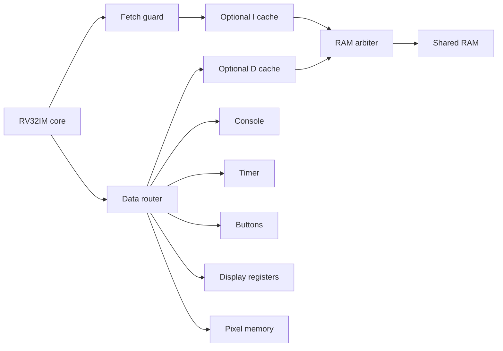

# RV32IMDeviceSystem

`rv32im.system.devices` composes the RV32IM five-stage core, one shared
256 KiB RAM, fetch guard, data router, RAM arbiter and device components.
Its whole implementation is structural. Existing native memory devices
provide scalable storage; existing smaller children remain selectable.

System/game acceptance is in progress on main `alpha`.
Short guest execution and a dedicated assembled-clock check have passed;
the milestone record tracks final native/WASM, game and compatibility results.

## Pins

| Pin | Direction | Width | Meaning |
| --- | --- | --- | --- |
| CLK | Input | 1 | Global rising-edge clock |
| RST | Input | 1 | Coordinated interface/core/device control reset |
| ENABLE | Input | 1 | CPU execution enable |
| TX_READY | Input | 1 | External console consumer can take one byte |
| INPUT_VALID | Input | 1 | Enqueue a logical button transition on this edge |
| INPUT_BUTTON | Input | 5 | Logical button ID, 0–31 |
| INPUT_DOWN | Input | 1 | Press when 1; release when 0 |
| TX_VALID | Output | 1 | Console has a byte |
| TX_DATA | Output | 8 | Oldest console byte |
| PRESENT | Output | 1 | Display command executes at the next sampling edge |
| FRAME_SEQUENCE | Output | 32 | Wrapping presentation counter |
| HALTED | Output | 1 | Core stopped at EBREAK |
| TRAPPED | Output | 1 | Core stopped with a terminal fault |
| TRAP_CAUSE | Output | 4 | Existing execution trap encoding |
| COMMIT_VALID | Output | 1 | Sample the retirement capability before this edge |

ENABLE controls the CPU. CLK still advances peripherals and accepted bus
transactions. A whole-machine pause in a future live runner must stop the
shared clock. External button/consumer inputs must meet setup/hold timing.

The recorded fixtures use the Unit profile, a 1,000-tick period and external
button changes one tick after falling edges. The dedicated all-state timing
check bounds the compact FF, cached FF and cached DRAM assemblies at 520 ticks
with those inputs fixed at rising-edge+501, RST=0 and ENABLE/TX_READY=1. This
certifies the actual 1,000-tick fixture clock; the 520 bound does not specify a
new input phase for a shorter clock. Expanded comparison profiles have observed
setup checks rather than an all-state assembled certificate.

## Internal routes

The optional cache stages forward only RAM addresses. Device registers and
pixels bypass both caches. The initial data cache uses unbuffered
write-through: its response waits for the backing write. Each CPU data
transaction completes before the next one; ordered pixel writes followed by
PRESENT therefore have a defined capture boundary. The guest library uses
volatile accesses and `fence iorw, iorw` around PRESENT. Further cache policies
need their own ordering/visibility evidence.

The [router reference](../device-io/address-router.md) defines the fixed map.
Speculative instruction fetch can reach only RAM, through the separate
[fetch guard](../device-io/instruction-guard.md). The existing arbiter merges
I/D RAM traffic; it does not select devices. Its burst rules remain unchanged.

## Parameters and initialization

- `caches`: 0 or 1, default 0; four direct-mapped sets and 16-byte lines.
- `dram`: 0 or 1, default 0; existing FF or DRAM backing endpoint.
- `timer_divisor`: positive 32-bit divisor, default 1.
- `timer_frequency_hz`: declared counter frequency, default 0 (unspecified).
- `width`, `height`: default 64×48; each dimension is 1–4096 and the surface
  contains at most 262,144 pixel bytes. Stride equals width, including arbitrary
  non-power-of-two widths.
- `video_bytes`: default 0 (automatic). Backing capacity is a power of two
  covering the visible surface, at least 4096 bytes by default. An explicit
  power-of-two capacity in 4096–262144 must cover the surface. The data router
  receives the same video aperture.
- `console_depth`, `button_depth`: 1–7 entries, default 4. These configure the
  existing FIFO children and their full/overflow behavior.

Defaults retain the initial platform ABI and child configuration. The larger
screen and queue variants have dedicated acceptance coverage; a geometry
parameter does not resize a guest program's own logical game board.

`loadElf()` accepts the existing strict ELF32 format, requires entry zero
and checks every segment against the RAM envelope. Before simulation it
clears RAM/video to known zero, then loads the ELF. Hardware RST retains
stored bytes while resetting controls and sequence; rebuilding/loading is a
separate host initialization operation. No array spans the high MMIO bases.

## Observation and recording

The root delegates pipeline/retirement observation to CORE. `FrameStateView`
returns a copy of the current indexed surface and a per-bit known mask,
geometry, sequence and capture-time tag. It is not a historical memory query.
The batch runner samples PRESENT before the edge, finishes same-edge
propagation, captures the surface, then advances to later writes. The screen
observer implements neither VGA/HDMI timing nor a simulated DMA copy.

The [recorded game mode](recorded-games.md) can capture bounded presentation
checkpoints for the original circuit visualizer. The topology and indexed
pin/wire values come from this actual assembly; device observations are saved
at the same settled boundaries. These captures retain no intermediate gate
transitions or memory-page history. The original component scenarios retain
their existing waveform playback. Headless runs turn off wire, register and
native-memory histories, including optional cache banks.

## Examples and checks

The small recorded scenario shows reset, disabled CPU and a queued button
input. It does not run an ELF.

<!-- simulator-examples: rv32im-device-system RV32IMDeviceSystemScenarioTest -->

<iframe src="../../simulator/?scenario=rv32im-device-system&amp;embed=1" title="RV32IM device system" loading="lazy" allowfullscreen></iframe>

<a href="../../simulator/?scenario=rv32im-device-system" class="md-button">Open the recorded circuit</a>

The `RV32IMDeviceSystem*Test` checks exercise an actual short guest with console,
timer, M arithmetic, pixel stores and PRESENT across structural/compact FF
and cached FF/DRAM configurations, including wide epochs. Recorded bring-up/game checks compare
retirements/registers, device samples, final RAM and immutable frames with
independent references. Full game and final artifact acceptance remain in
progress; see the maintained milestone record for actual results.
