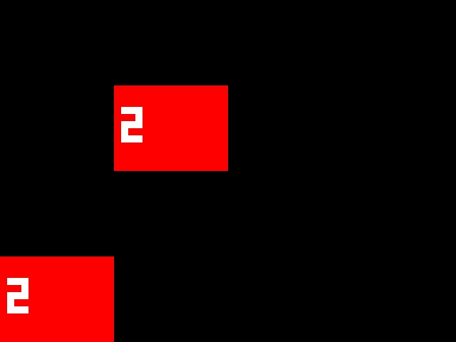

# Recorded games

Batch mode runs alongside circuit playback. It executes
freestanding RV32IM software with predetermined device inputs, captures
console output and RGB332 frames, and ends at EBREAK. The compiled bring-up program has completed actual native and WebAssembly
circuit execution with checked console, pixels and reports. The saved 2048
captures below are from checked native execution. Full game-suite and
native/WebAssembly acceptance remain in progress.

## Games in the circuit visualizer

<a href="../../simulator/?recording=../assets/rv32im/circuits/pong-rally.json" class="md-button md-button--primary">Open Pong in the circuit visualizer</a>

Press **Play** on the original timeline. The display component shows the
game screen; the buttons component shows recorded input levels and queue
state. Select either component for its inspector preview. **Device views**
switches between device abstractions and the available circuit detail.
The CPU, router, RAM and device hierarchy all come from the same simulated run.

This capture contains 18 settled PRESENT checkpoints from an actual native
RV32IM Pong rally. All 18 screens match the host reference. Pin and wire
values, display pixels and device state are captured together. The timeline
steps between those retained checkpoints; intermediate gate transitions and
memory pages are unavailable. Replay does not start another simulation or
accept live keyboard input. The capture's fidelity and clock are fixed;
component selection, navigation and layout editing remain available.
The [capture evidence](../assets/rv32im/circuits/pong-rally.evidence.json)
identifies the native binary, source snapshot, ELF, script and frame hashes.

## Programs

| Guest | Workload |
| --- | --- |
| Bring-up | Console greeting, timer/button read, colored pixels and a moving square |
| 2048 | Directional compaction, one merge per tile, deterministic spawning and restart |
| Sokoban | Walls, crate pushes, goals and restart |
| Snake | Queued direction taps, grid updates, food, growth and collision |
| Pong | Both players' levels, ball motion, paddle/wall bounce and misses |
| Tetris | Seven tetrominoes, rotation, horizontal moves, hard drop, line clear and top-out |

The initial fixtures use a fixed seed/level and three down actions per game.
Separate acceptance fixtures start with a 2048 merge board, a Tetris line-clear
board, Snake near a wall, and a Pong rally. The rally performs 17 finite
guest-controlled updates after one scripted start event.
Snake also receives a release between polls. Arcade movement uses explicit
scripted update actions in these short fixtures. Host rule tests exercise
additional boundaries. This is finite scripted execution, not sustained
interactive play or a measured FPS promise.

## Saved captures

These frame-only exports belong to the source snapshots identified in their
capture manifest. They replay actual native circuit output at one frame per
second; that replay speed is independent of simulation throughput. The JSON
files retain the captured pixels, keyboard snapshots and run evidence.

| Recording | Captured frames | CPU cycles | Native execution time |
| --- | ---: | ---: | ---: |
| [Bring-up](../assets/rv32im/recordings/bringup.gif) | 2 | 38,811 | 137.36 s |
| [2048](../assets/rv32im/recordings/2048.gif) | 4 | 169,601 | 619.79 s |

{: style="image-rendering:pixelated;max-width:100%" }

To inspect individual frames and their keyboard state, open the
<a href="../../simulator/games.html">recording viewer</a>, then use
**Open recording** with the downloaded
[2048 JSON](../assets/rv32im/recordings/2048.json) or
[bring-up JSON](../assets/rv32im/recordings/bringup.json).
The [capture manifest](../assets/rv32im/recordings/manifest.json) identifies
the source binary, guest/script manifest, recording and frame hashes.
Bring-up has passed baseline, repeat, event-quantum and expanded-core checks.
The saved 2048 baseline matches the exact host reference; its other
configurations and the remaining game acceptance checks are in progress.

## Guest and device boundary

`tools/rv32im/guest` owns original game rules, startup/BSS/linker setup, volatile
MMIO access, integer drawing, tile glyphs and a deterministic PRNG. Code and
assets are preloaded. The logical game boards retain their 64×48 drawing area. The platform drawing
library reads/caches physical width, height, stride and RGB332 format from the
display registers, clips to that surface and aligns word stores to the actual
row address. `clear_screen` clears the declared physical surface. Larger
displays do not automatically scale the logical game board. The guest issues
PRESENT; the host copies and scales those pixels.

Buttons use logical IDs: up/right/down/left 0–3, action/drop 4, restart 5,
scripted update 6, player-two up/down 7–8 and pause 9. Reads of event-head are
nondestructive; a POP store consumes one transition. The fixed input FIFO
retains taps and reports overflow. The runner checks levels/queue behavior
independently at the execution edge.

The report page at `0x3f000` contains magic/version, game ID, action count,
score, terminal state, state fingerprint, sampled timer and queue status.
It is ordinary RAM written by the guest. Guest restart reinitializes game
rules and redraws; it does not reset the simulated CPU/devices.

## Build and run

Use the existing pinned GCC 12.4 RV32IM/ILP32 toolchain with the scoped build
helper. It audits every final text instruction and records compiler, source,
ELF and input hashes in `tests/fixtures/rv32im/games/manifest.json`.

```sh
python3 tools/rv32im/build-guests.py --compiler /path/to/riscv-none-elf-gcc
cmake -S . -B build-games -DCIRCUITSIM_DEPLOY_PYTHON=OFF \
  -DCIRCUITSIM_SPLIT_DELAY_TABLES=ON
cmake --build build-games --target RecordedGuestProbe -j1
python3 tools/rv32im/run-recorded.py bringup \
  --runner build-games/tests/RecordedGuestProbe --output build-games/bringup
```

To capture a game for the original circuit visualizer, build and run the
native checkpoint exporter:

```sh
cmake --build build-games --target RecordedCircuitProbe -j1
build-games/tests/RecordedCircuitProbe pong-rally new-pong-circuit.json
node tools/package-recorded-circuit.mjs new-pong-circuit.json \
  visualizer-v2/layout.json build-games/pong-view.json
```

Serve `pong-view.json` and its generated layout sidecar on the same site,
then pass the recording's relative URL through the visualizer's `recording`
query parameter. Packaging keeps only the layouts used by that circuit;
the browser loads detailed wiring progressively as you zoom. The exporter supports the same
packaged guest names, refuses an existing output file and limits retained
circuit data to 24 MiB and 64 checkpoints. The browser accepts at most 32 MiB.
Only a completed, checked guest produces a recording. Memory and gate history
stay disabled during the run.

Keep builds/runs serial and resource bounded on this host. The CLI has cycle,
wall-time and address-space limits; choose a fresh output directory for each
run so an earlier recording cannot be mistaken for a failed rerun.
`stderr.log` receives cycle/retirement progress while the guest runs.
The evidence includes hashes of the recording bytes and each captured frame.
The underlying runtime also bounds
instructions, events, input and frames. Console output and device-read evidence
are each capped at 65,536 entries; lower limits can be selected through the
C++ batch options. The viewer accepts files up to 32 MiB. Exhausted limits or
failed reference checks are failures.

`--width 97 --height 65` selects an odd-width physical surface for compiled
bring-up checks; the default remains 64×48.

The resumable `tools/rv32im/accept-recorded.py --runner PATH --output DIR`
runs all ten guests serially in baseline, repeat, event-quantum 97 and expanded
core configurations, checks exact host references, and writes performance
and provenance summaries. Reuse requires matching code, binary and fixture
hashes. Partly written recordings are retained in an incomplete archive.

For fidelity/quantum comparisons, the CLI also accepts `--quantum-events 97`
and `--logic-profile expanded-core`. The latter expands the CPU assembly with
compact children; `structural` expands all available logic. The default is
`compact`. Recordings identify their profile name and fingerprint. Different
profiles may have different event counts; architectural results and captured
device outputs must agree at the tested operating clock. Expanded profiles are
comparison equipment: their runs check setup violations, but the all-state
assembled clock certificate currently covers the compact configurations.

`tools/build-pages.sh` packages the browser worker and WASM assets. Serve that
generated site to run scripts in the browser or open native CLI recordings.

Open the additive <a href="../../simulator/games.html">recording viewer</a>, run a packaged
script in its worker or load the exported `recording.json`. The circuit
visualizer remains available separately. Frame scrubbing/replay does not
execute guest instructions. Replay FPS is a display setting; run evidence
reports simulated cycles, host execution time and capture cost separately.
Unknown pixel bits are shown in magenta.

## Verification boundary

The runner checks CPU retirement/registers through the independent I/M
instruction oracle. Separate models check RAM/video, console, timer and
buttons; device read values are sampled at backend execution and retained
across waits. PRESENT captures are checked against ordered guest stores.

Strict host C rule tests assert boundary cases. Host C reference runs provide
expected guest reports and exact rendered bytes for comparison with compiled
RV32IM execution. The host adapter is test equipment and is excluded from
the audited RISC-V binaries. Native/WASM and repetition/quantum comparisons,
integrated timing, browser checks, old regressions and performance evidence
remain milestone acceptance gates.

## Display and keyboard views

Captured geometry sets the canvas size; it is not fixed to 64×48. Each
dimension is at most 4096 and each frame may contain up to 262144 pixel bytes,
including row padding, with a 4 MiB aggregate pixel budget per
recording and the existing 32 MiB file limit. RGB332 conversion and unknown
pixel colors are shared with the circuit device preview.

A keyboard panel follows the inspected frame's logical input levels, queue
count and overflow. The saved input events carry exact virtual ticks and
sequence numbers. These are observations of input accepted by the device,
not keyboard controls for a running guest. Older recordings without input
snapshots still open and explicitly report that no keyboard snapshot exists.
Malformed keyboard snapshots are rejected before drawing; they must contain
four-state input levels and the device's queue/head/overflow fields. Current
game devices use 32 levels; component snapshots may declare `buttonCount`.
